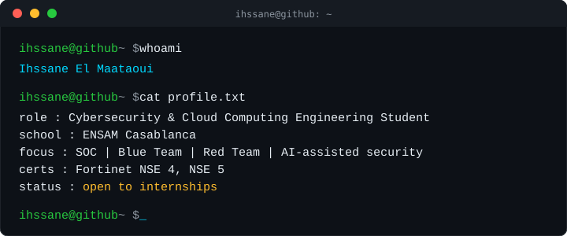

🛡️ Cybersecurity & Cloud Computing student from Morocco 🇲🇦

 

---

## 🎯 About Me

- 🎓 2nd-year engineering student in **Cybersecurity & Cloud Computing** at **ENSAM Casablanca**
- 🔍 Interested in **SOC operations, threat detection, MITRE ATT&CK** and **AI applied to security**
- 🧪 Building labs: SIEM, red team automation, network segmentation
- 🏁 CTF player and continuous learner
- 📫 Looking for an **internship in SOC / Blue Team / Red Team**

---

## 🚀 Featured Project

### 🤖 [SOC Lab: AI-assisted Alert Triage](LIEN_DU_DEPOT)
A complete SOC built around **Wazuh**, with an intelligent triage agent (**LangGraph + Ollama**) and a semantic **RAG** over **709 MITRE ATT&CK techniques** (**80% precision@3**). Includes a Streamlit dashboard and a conversational "SOC Copilot".

---

## 📂 Other Projects

| Project | Description | Stack |
|---|---|---|
| [Mini SIEM](LIEN) | Real-time detection, log correlation and automatic alerts | Python, Splunk, Linux |
| [Red Team Automation Lab](LIEN) | Automated detection-testing pipeline (isolated lab, educational use) | Python, Bash, Metasploit |
| [Barco ClickShare Design](LIEN) | VLAN isolation, WPA2/WPA3 Enterprise, AES-256, CapEx/OpEx analysis | Network design |

---

## 🧰 Tech Stack

**Security & SOC**

**Languages & AI**

**Systems & Infrastructure**

---

## 🏅 Certifications

- **Fortinet NSE 5**: Certified in Security Operations
- **Fortinet NSE 4**: Network Security Professional

**🚧 In preparation**

---

⭐ Thanks for visiting! Feel free to connect.

